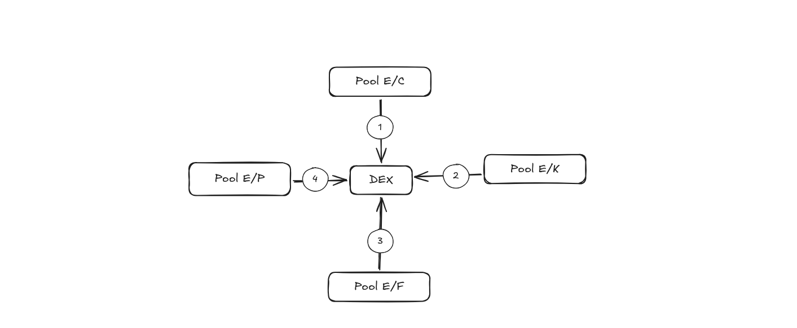
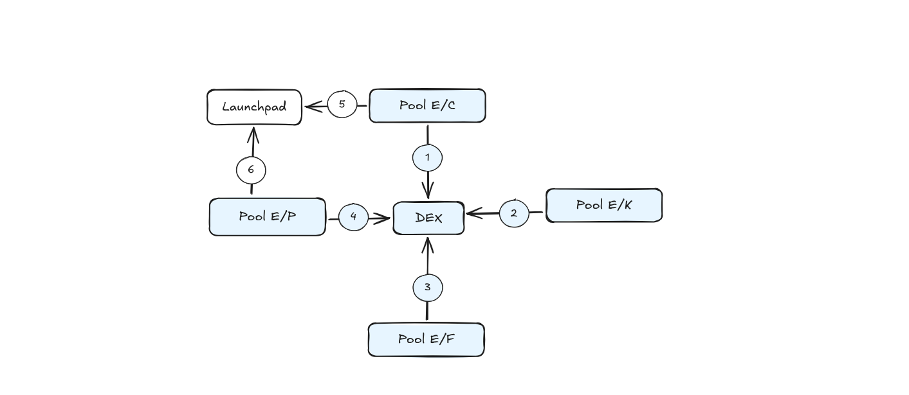
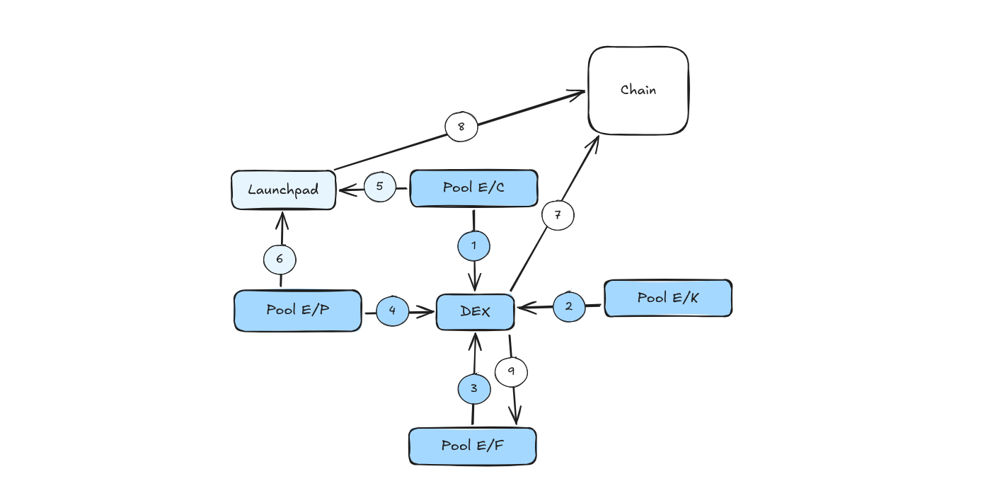
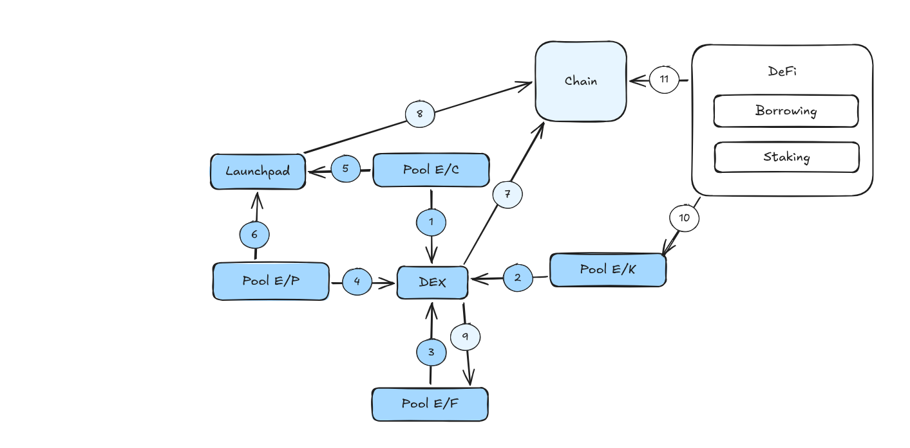
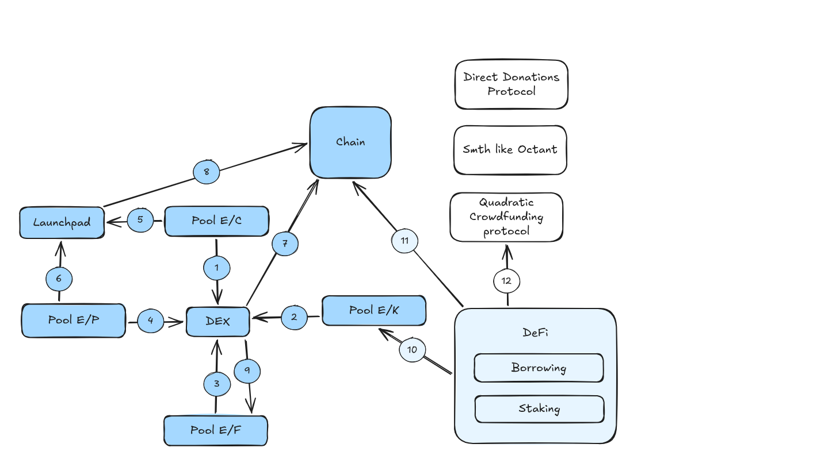
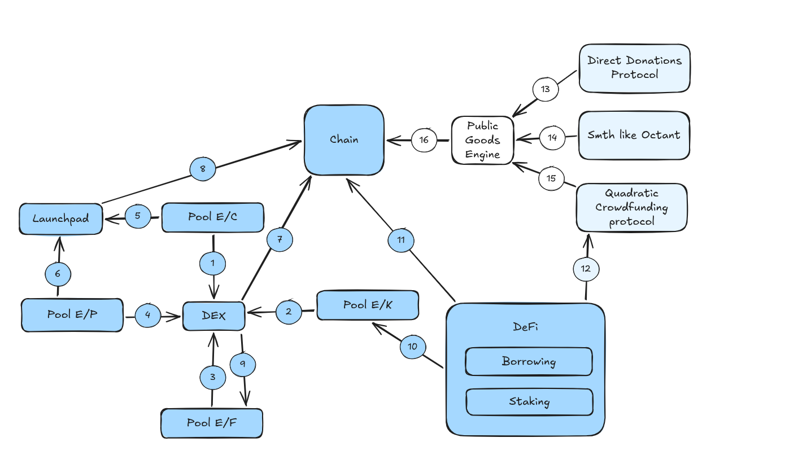
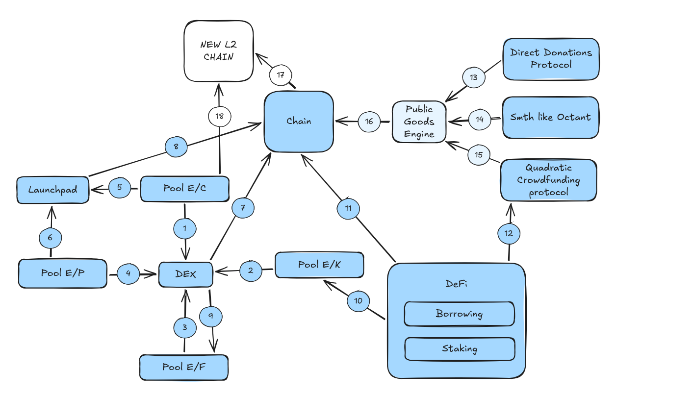

# Liquid DAO

*A shared core for organizations that can evolve*

## Part I. The Idea

### 1. “Any dystopia is a utopia you cannot leave.”

Leaving something behind is part of life and the price of progress, both personal and global. However, leaving becomes difficult when what we have built cannot leave with us. Money may be transferable, while reputation and influence remain tied to the entity we leave.

The more we contribute, the more costly departure can become. This is the point at which centralization takes hold and becomes dangerous.

These tensions exist in companies, labor organizations, groups of friends, cities, and states.

And, most importantly for this paper, similar tensions exist in DAOs.

But why does this matter?

It is not only about a general dislike of centralization or the dangers it brings. The ability to separate is also a condition for evolution. Species, entities, and societies split to follow different paths of development. These branches later meet and often reunite, and progress emerges from this diversity. For one to become many, you, I, and anyone else must be able to leave.

Returning to DAOs: without room to evolve, they risk becoming increasingly centralized and remaining artifacts of their past. A participant can leave, but the recognition of their experience, reputation, and contribution may remain tied to the organization. The Voting Power they acquired there does not necessarily follow them elsewhere.

Here, Voting Power means the broader ability to shape collective decisions: both formal voting weight and the standing that makes others take a participant's judgment seriously. A person retains their experience when they leave, but a new organization may not recognize what that experience meant in the old one.

Tradable tokens offer one way to move between DAOs: sell in one place and buy in another. This makes it easier to move capital and acquire formal voting weight. Yet selling a balance does not transfer the holder's reputation, and buying a large balance does not by itself make a newcomer a trusted voice. The history behind a proposal can matter alongside the votes available to pass it.

The closer governance comes to recognizing actual contribution and reputation, the more important mechanisms for evolution become. Otherwise, the very things that make someone's participation meaningful also make departure costly.

This is why we need DAOs that people can leave together without losing the recognition and Voting Power they have built.

### 2. “We need more DAOs — but different and better DAOs.”

What, then, should a person be able to preserve when leaving a DAO? The accumulated standing through which their contribution has become Voting Power.

There can be no single rule for how that standing is earned. Someone may write an application and give it to a DAO. Another person may provide liquidity or do work that sustains the organization. Even if they earn money from that activity, its value to the DAO can exceed what their share of ownership suggests.

These contributions differ, but they raise the same question: how much weight should a participant have in collective decisions? Each DAO answers according to its own purpose. The resulting Voting Power has a common role even when its sources are entirely different.

How, then, can we apply “Code is law” when every DAO has different laws?

The shared law belongs at the level of how organizations exist, relate, and change. It must allow different sources of Voting Power to coexist, rather than prescribe one source for everyone. Each DAO can determine what it values within a framework that allows what has been recognized to remain meaningful beyond its original boundaries.

Nature offers an analogy. The succession of seasons brings different inhabitants and events, while underlying physical processes make this variety possible. Those processes establish the conditions within which different forms of life develop; they do not prescribe a single form for the whole ecosystem.

The same principle can guide governance. Shared rules can establish how organizations recognize Voting Power, relate to one another, and continue in new forms, while remaining independent of how a participant originally earned that power. The question is how to preserve continuity as the rules and purposes around it change.

### 3. Hierarchy, Autonomy, and Diversity

Organizations can have different internal rules and still face tasks they need to undertake together. Recognizing one another's participants allows them to acknowledge contribution across their boundaries. Governing a shared undertaking also requires a level at which they can make collective decisions.

Nesting provides that level. An organization can belong to a larger organization while retaining its own purpose, rules, and participants. The larger whole governs their shared undertaking, while its constituent organizations retain autonomy over their own affairs. This allows local differences to coexist with cooperation at a broader scale.

This is hierarchy in the sense of relationships between levels. Authority can remain distributed across those levels, with decisions about shared matters made together and local decisions left to the organizations concerned. Diversity across scales requires room for this nesting.

These relationships also give Voting Power a context in which to receive recognition beyond its original organization. A larger DAO can recognize participation in the DAOs within it, and separate organizations can recognize one another without forming a hierarchy. The resulting structure can include hierarchies, alliances, and overlapping affiliations.

The ability to separate and the ability to form larger wholes are complementary. Separation allows different paths to emerge; nesting allows them to cooperate across scales. Together, they create the structure within which diversity can evolve.

### 4. What Makes Governance Liquid

Liquid DAO brings together two things that must be able to evolve: Voting Power and the relationships between organizations.

Voting Power gives a common expression to participation whose sources can differ from one organization to another. Relationships allow another organization to recognize that Voting Power under its own rules. Forking allows a new branch to inherit an existing distribution as its starting point. These paths preserve continuity while allowing different rules and purposes.

The model is liquid because both can change. People can gain or lose Voting Power as their participation changes. Organizations can connect, nest, separate, and form new shared structures while preserving continuity with what their participants have already built.

The aim is an ecosystem in which different forms of authority and organization can develop together, and in which taking a new path does not require starting from nothing.

## Part II. The Proposed Core

### 5. A Singleton for Organizational Hierarchies

The proposed core gives the hierarchy described above a shared representation: each DAO has a distinct record, connections identify which DAOs recognize one another, and recognition rules determine how Voting Power in one DAO contributes to Voting Power in another. All of these records follow one standard.

The Singleton design brings this state into one core contract. It holds the DAOs, their connections, and their Voting Power records, so recognition rules can operate on the same shared state. Each DAO remains a distinct organization with its own rules. This shared structure is the architectural foundation of the proposal.

[Uniswap v4](https://developers.uniswap.org/docs/protocols/v4/concepts/poolmanager) provides the architectural reference: its PoolManager holds the state of multiple separately identified pools in one singleton contract. Liquid DAO applies the same architectural pattern to organizations and their connections.

Related calculations run within the shared core. Reusing logic can reduce repeated deployments and external calls; any gas savings require measurement.

A common interface makes this state accessible. Applications can read Voting Power and relationships, while a wallet-to-DAO index would let them query a wallet's participation across the deployment. [ERC-20](https://eips.ethereum.org/EIPS/eip-20) provides the interface reference: shared operations allow applications to work with different tokens. Liquid DAO seeks the same compatibility for organizations with different governance rules.

The Singleton brings the state together; the common interface lets other systems work with it. Separate deployments can follow the same standard.

### 6. Scores as Voting Power

In the technical model, **Score is the numerical representation of a participant's Voting Power in a particular DAO: Score = Voting Power.** In a one-token-one-vote DAO, a participant's token balance determines their Voting Power; in Liquid DAO, their Score plays that role.

When a DAO's rules reflect how its participants actually recognize usefulness and trust, its Scores express that judgment. Inheriting or recognizing those Scores carries the judgment forward.

A contribution is an action or activity the DAO recognizes. Its rules determine how that activity changes a participant's Score. Reputation describes the recognition of a participant's work; it is not a separate numerical layer between Score and Voting Power in this model.

Each DAO chooses its sources of Voting Power: other DAOs, other smart contracts it chooses to connect, or a combination of both. A source does not need a DAO of its own. The receiving DAO configures formulas that determine how information from each source contributes to participant Scores.

These sources may represent protocol use, liquidity provision, completed work, governance participation, or verified roles. Modules can report qualifying activity to the core, which applies the DAO's rules to update the Score. Updates may occur at selected thresholds or in batches.

Each DAO defines how its Scores grow or decline. One may grant Voting Power quickly and reduce it after inactivity. Another may require sustained contribution. [Colony](https://docs.colony.io/learn/governance/reputation/) provides an existing reference for contribution-based reputation and decay.

A DAO can also use a participant's Score in another DAO as an input. The source Score already represents that participant's Voting Power in the source DAO. The receiving DAO applies its recognition formula to determine how much this adds to the participant's Score—and therefore Voting Power—in the receiving DAO. It chooses the source, the formula, and the conditions for changing or removing the connection.

For example, a participant with a Score of 4 in a pool DAO has 4 units of Voting Power there. If the DEX DAO recognizes that Score at a weight of 0.5, it contributes 2 to the participant's DEX Score. If a network DAO then recognizes the DEX Score at a weight of 0.5, those 2 units contribute 1 to the participant's network Score. Assuming no other sources, the participant has Voting Power of 4, 2, and 1 in the three DAOs respectively. Each step uses the source DAO's Score, including the recognized contributions already reflected in it.

These connections form a directed graph of Score calculations. A participant's live Score is their current Voting Power in that DAO. Voting systems can use a snapshot of Scores to fix Voting Power for a particular decision; they do not introduce another conversion from Score to Voting Power. The implementation must specify the state and calculation rules used to reproduce that snapshot.

### 7. The Ability to Leave: Forking a DAO

We can now return to the starting question: what does it mean to be able to leave? In this system, it means being able to branch from an existing DAO with the Voting Power its participants have already accumulated.

The proposed core should support a single fork command that creates a mirror DAO from a governance snapshot. The snapshot preserves participants' Scores, the rules that produced them, and the relevant state of their sources. The new DAO inherits that distribution of Voting Power as its starting point.

The group creating the fork selects the new branch's sources of Voting Power and configures its formulas as part of the fork operation itself. It can connect different DAOs or smart contracts and assign different weights to their inputs. The branch is created with this configuration already in place, so choosing it does not require first winning a vote under the inherited distribution.

An inherited minority can therefore become a majority over time as participation under the new branch's rules changes the distribution of Scores. The inherited balance provides continuity without permanently fixing which group holds power.

Like a cell dividing, one DAO can become two independently developing organizations. The original continues to operate, while the new branch develops from the inherited state under its own configuration. The fork itself creates no automatic synchronization between branches. Explicit recognition links, if configured, can still affect a branch's Scores.

Creating the fork should not require permission from the original DAO's leadership or a successful vote in that DAO. Participants can choose which branch to support and remain active in both. Their past participation provides a starting point for a different future.

### 8. What Makes the Core Liquid

Technically, Liquid DAO requires a shared core with the following functions:

- **Shared state:** maintain distinct DAOs and their participant Scores in one Singleton.
- **Score updates:** use selected DAOs and other smart contracts as sources, applying each DAO's formulas to calculate Voting Power.
- **Relationships:** record connections between DAOs and apply recognition formulas across nested and overlapping structures.
- **Common access:** expose Scores, relationships, and participation through a standard interface for applications and voting tools.
- **Snapshots and forks:** fix Voting Power for a decision or create a DAO that inherits the starting distribution, with new sources and formulas configured at the moment of separation.

Together, these functions let Voting Power and organizational relationships evolve within the same system. Each DAO can retain its own treasury and execution tools.

## Part III. Example: An Ecosystem in Motion

### 9. The Ecosystem Example

The following example shows how Liquid DAO could connect organizations across an EVM ecosystem. It illustrates possible relationships rather than prescribing a single architecture.

*Diagram legend: “Chain” denotes the Network DAO. Arrows point from a source of Voting Power to the DAO that recognizes it.*

#### Liquidity-Based DAOs for a DEX

Consider a DEX with four liquidity pools, each governed by a local DAO. Liquidity providers receive Voting Power over pool-level matters such as liquidity caps, insurance, and fees. Uniswap v4 hooks provide a possible integration point for such local governance.

The DEX DAO recognizes Voting Power from all four pool DAOs. Providing liquidity can therefore give a participant a voice in both local pool decisions and exchange-wide matters, including upgrades and grant programs.

**Connections 1–4** represent the DEX DAO's recognition of pool Scores. The DEX DAO controls both the formulas and which pools it recognizes. It can give additional weight to low-liquidity pools or exclude a malicious pool through its governance.

#### The Launchpad DAO

A launchpad DAO governs protocol upgrades, fees, and other shared decisions. It recognizes liquidity provision in pools containing tokens launched through its platform.

Tokens C and P were launched through this platform, so **connections 5 and 6** recognize participation in their pools. These additional governance roles can influence where participants provide liquidity, making DAO partnerships a competitive advantage.

#### The Network DAO

The Network DAO governs shared network-level matters. It recognizes Voting Power from the DEX and launchpad through **connections 7 and 8**. Because both organizations recognize pool participation, a liquidity provider can gain a voice at the pool, protocol, and network levels.

#### Mutual Recognition

Recognition can also run in the opposite direction. Through **connection 9**, a pool DAO can recognize the DEX DAO's Scores, giving wider DEX participants a role in its local governance. The pool could separately offer fee discounts to frequent DEX users as an incentive to participate.

Reciprocal connections require a rule that bounds recursive calculations. One option considered here is a maximum recognition depth of three levels.

#### Recognition of Non-DAO Protocols

DAOs can also recognize activity recorded by contracts without their own governance, such as staking or borrowing protocols.

Through **connection 11**, the Network DAO recognizes this activity. **Connection 10** shows that a local pool DAO can use such sources too. Each receiving DAO chooses its sources and formulas. Integration requires a way for the core to read or receive the relevant activity records.

#### Public Goods DAOs

A public goods funding protocol can use recognized DeFi participation as an eligibility condition. For example, a quadratic crowdfunding protocol could require participants to have contributed to the network's DeFi ecosystem. **Connection 12** illustrates this choice; the protocol can change the condition through its own rules.

The Public Goods Engine allocates additional donations using participation recognized from public goods organizations through **connections 13–15**.

The Network DAO recognizes the Public Goods Engine through **connection 16**, giving public goods participants a voice alongside participants in financial protocols.

#### Cross-Chain Recognition

Another L2 can recognize Scores from the Network DAO through a bridge (**connection 17**) and from a pool containing that L2's wrapped token (**connection 18**). These connections can give existing participants a role in a new ecosystem.

#### Integration Costs

These relationships add computation and integration costs. Their practical value depends on whether governance and coordination benefits justify those costs; this requires implementation and measurement.

### 10. A Launchpad Splits

#### A Disagreement About Direction

Suppose the launchpad focuses on established projects. A minority wants to fund early experimental projects, including those without a liquid token or substantial pool. Its members review projects and support developers, but the existing formulas mainly reward activity associated with established projects. Their work does not earn enough Voting Power to change the launchpad's direction.

#### A New Configuration at Separation

The group submits a fork command with a snapshot and the new branch's sources and formulas. The branch inherits participant Scores and the starting distribution of Voting Power, together with the records explaining that state.

At creation, the new branch is configured to recognize contracts recording reviews and technical support for early projects. Its formulas determine how subsequent work changes Scores. Choosing this configuration requires neither approval from the original DAO nor a prior majority under the inherited distribution.

The original DAO continues with its own configuration and Scores. The fork itself creates no automatic synchronization between branches. Explicit recognition links, if configured, can still affect a branch's Scores.

> **Additional Diagram A — The Fork:** Show the original and new launchpad DAOs with the same starting Scores, and the new branch's sources and formulas selected at separation.

#### From Minority to Majority

At the snapshot point, participants supporting established projects hold 60 units of Voting Power, while the experimental-project group holds 40. Both DAOs begin with this distribution.

Suppose the experimental-project group earns another 50 units through qualifying reviews and technical work in the new branch. Assuming no other Score changes:

| Point in the example | Established-project group | Experimental-project group | Experimental group's share |
| --- | ---: | ---: | ---: |
| Snapshot inherited by both DAOs | 60 | 40 | 40% |
| New branch after the additional work | 60 | 90 | 60% |
| Original DAO, assuming no other changes | 60 | 40 | 40% |

The new rules apply to anyone doing the qualifying work, including members of the original majority. They reward activity rather than permanently privileging the group that created the fork.

> **Additional Diagram B — Voting Power Over Time:** Show the inherited 60/40 distribution and the later 60/90 distribution in the new branch, with the original DAO on a separate timeline.

#### Different Decisions Become Possible

The new majority approves funding for an experimental project that would not have passed the original launchpad's selection policy. The original DAO continues to support established projects.

The fork establishes governance. Deploying the new launchpad's application, connecting execution tools, and funding its treasury are separate steps. Assume these resources are in place when the funding decision is executed.

The two launchpads share a governance history but follow different paths. Participants can contribute to either or both, earning Scores under each organization's rules.

### 11. Two Branches in One Ecosystem

The rest of the ecosystem does not have to split. Each receiving DAO chooses whether to recognize the original launchpad, the new branch, or both, and at what weight. Inheriting a snapshot does not automatically grant the new branch the original's external recognition. The DEX and its pools can continue serving projects from either launchpad.

### 12. A Utopia You Can Leave

The paper began with a thought: any dystopia is a utopia you cannot leave.

Liquid DAO aims to let accumulated contribution become the starting point for another organization. People can leave together, pursue different rules, and remain connected to a wider ecosystem. Their shared past can support new directions instead of binding them permanently to one structure.

That possibility keeps organizations open to further evolution.

### 13. Why This Is V1

I still consider Liquid DAO a rough, evolving concept. This first version sets out the direction I want to explore, while many of its claims and technical details still need to be developed and made more precise.

Over the next six months, I hope to publish a follow-up paper with clearer claims and a complete proposed code architecture, including the core contracts, data structures, and interfaces. The goal is to turn this concept into a concrete technical proposal that others can review, challenge, and build on.

<!--
Original ecosystem example: https://github.com/no-hive/liquid_dao/blob/cb8cdca5a423cdb97d86dff4bef9804c29f06faa/whitepaper_light_theme.md
The ecosystem example was adapted and shortened; diagram assets and connection numbers were preserved.

MIT License

Copyright (c) 2026 no-hive

Permission is hereby granted, free of charge, to any person obtaining a copy
of this software and associated documentation files (the "Software"), to deal
in the Software without restriction, including without limitation the rights
to use, copy, modify, merge, publish, distribute, sublicense, and/or sell
copies of the Software, and to permit persons to whom the Software is
furnished to do so, subject to the following conditions:

The above copyright notice and this permission notice shall be included in all
copies or substantial portions of the Software.

THE SOFTWARE IS PROVIDED "AS IS", WITHOUT WARRANTY OF ANY KIND, EXPRESS OR
IMPLIED, INCLUDING BUT NOT LIMITED TO THE WARRANTIES OF MERCHANTABILITY,
FITNESS FOR A PARTICULAR PURPOSE AND NONINFRINGEMENT. IN NO EVENT SHALL THE
AUTHORS OR COPYRIGHT HOLDERS BE LIABLE FOR ANY CLAIM, DAMAGES OR OTHER
LIABILITY, WHETHER IN AN ACTION OF CONTRACT, TORT OR OTHERWISE, ARISING FROM,
OUT OF OR IN CONNECTION WITH THE SOFTWARE OR THE USE OR OTHER DEALINGS IN THE
SOFTWARE.
-->
